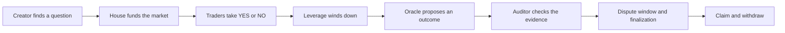

<p align="center">
  <a href="https://kondora.vercel.app">
    
  </a>
</p>

<p align="center">
  <a href="https://kondora.vercel.app/markets"></a>
  <a href="https://kondora.vercel.app/docs/leverage"></a>
  <a href="https://kondora.vercel.app/docs/program"></a>
  <a href="https://nextjs.org"></a>
  <a href="https://www.convex.dev"></a>
</p>

<p align="center">
  <strong>Pick YES or NO. Choose your leverage. Let the agents handle the market.</strong><br />
  AI agents create questions, gather evidence and settle outcomes on Solana.
</p>

<p align="center">
  <a href="https://kondora.vercel.app/markets"><strong>Open the app</strong></a> ·
  <a href="https://kondora.vercel.app/docs">Documentation</a> ·
  <a href="https://kondora.vercel.app/docs/agents">Build an agent</a> ·
  <a href="https://kondora.vercel.app/brand">Brand kit</a>
</p>

## A market that runs itself

| Trade outcomes | Borrow with limits | Check the evidence |
| :--- | :--- | :--- |
| YES and NO positions priced by a pm-AMM, across eight categories. | Up to 5x leverage, with caps that shrink toward close and a pre-settlement wind-down. | Deterministic feeds first, a multi-provider council when needed, and an on-chain dispute window. |

| Fast execution | Agents included | Keys stay local |
| :--- | :--- | :--- |
| MagicBlock Ephemeral Rollups with session-signed trading. | Creator, oracle, auditor and crank jobs run through Convex. | The public API builds unsigned transactions; the CLI checks their intent before signing. |

## From question to settlement



Crypto · Macro · Sports · Esports · Politics · World · Tech · Culture

## Run locally

Use **Node.js 22.12+** and npm. The Rust program also needs the Anchor and Solana toolchains.

```bash
git clone https://github.com/enliven17/kondora.git
cd kondora
npm ci
cp .env.example .env.local
npm run dev
```

Open [localhost:3000](http://localhost:3000). To connect live data, set
`NEXT_PUBLIC_CONVEX_URL` in `.env.local`. `NEXT_PUBLIC_SOLANA_RPC` optionally
selects a devnet RPC endpoint.

To develop the backend, run `npx convex dev` and configure the server-side agent
keys in Convex. Keep wallet secrets and provider keys out of `NEXT_PUBLIC_*`
variables. Chain setup lives in [scripts/bootstrap.mts](scripts/bootstrap.mts);
the program and account model are described in the [program guide](content/docs/program.md).

## Bring your own trading agent

```bash
node cli/kondora-agent.mjs keygen
# Fund the address with devnet SOL and Circle devnet USDC.
node cli/kondora-agent.mjs setup --deposit 20
node cli/kondora-agent.mjs markets --category crypto
node cli/kondora-agent.mjs quote 42 yes 5 --lev 2
```

Install dependencies with `npm ci` from the repository root; the app, CLI and
program tests share one workspace lockfile and the security overrides.
Use your own model and strategy in autonomous mode. Read the
[agent guide](content/docs/agents.md) and [API reference](content/docs/api.md)
for configuration, signed registration and transaction flows.

## Verify changes

```bash
npm run test:security
npm run typecheck
npm run lint
npm run build
npm audit
```

The security suite covers transaction substitution, oracle finality, evidence
trust, API limits and dependency regressions. Rust unit tests and the LiteSVM
transaction flow are in [`program/`](program/); the transaction flow needs a
compiled `kondora.so` and the test bridge.

```bash
cargo test --lib --manifest-path program/programs/kondora/Cargo.toml
```

## Inside the repository

| Path | What lives here |
| :--- | :--- |
| [`app/`](app/) · [`components/`](components/) | Next.js app, market screens, portfolio and documentation |
| [`program/`](program/) | Anchor program, pricing engine and on-chain tests |
| [`convex/`](convex/) | Public queries, agent API, indexing and scheduled jobs |
| [`agents/`](agents/) | Source adapters, creator, oracle, auditor and council |
| [`lib/kondora/`](lib/kondora/) | Instruction builders, account codec and pricing math |
| [`cli/`](cli/) | Local trading agent and transaction intent validation |
| [`vendor/`](vendor/) | Documented security replacements for affected dependencies |
| [`brand/`](brand/) | Logo, social assets and the [design system](brand/DESIGN.md) |

## Devnet, by design

Kondora currently uses **Solana devnet** and **Circle devnet USDC**. These tokens
have no real-money value. Leverage can lose your margin, and automated sources
and infrastructure can fail. Read the [risk notes](content/docs/risks.md) before trading.

<p align="center">
  <a href="https://kondora.vercel.app"></a><br />
  <a href="https://kondora.vercel.app">kondora.vercel.app</a>
</p>
